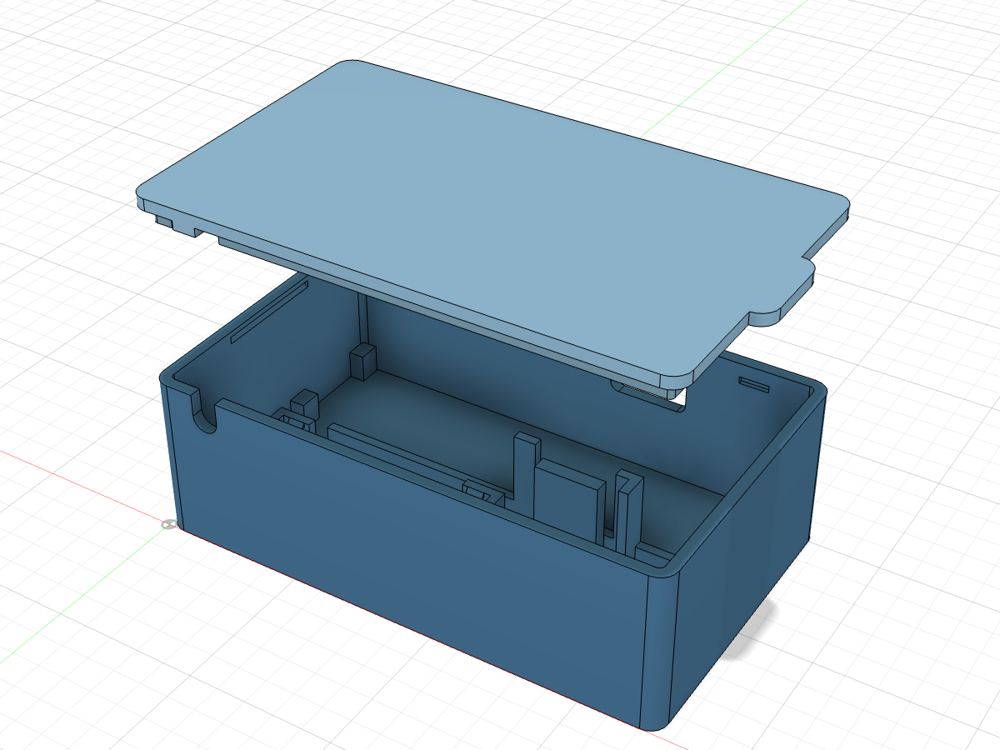

# OpenSCAD vs Fusion for p006's printed parts

Both versions describe the same p006 phase 2 parts:
- [../cad/p006_parts.scad](../cad/p006_parts.scad): OpenSCAD, 514 lines.
- [p006_fusion/p006_fusion.py](p006_fusion/p006_fusion.py): Fusion, 1,143 lines of Python
  (ruff-formatted)
  driving a parametric Fusion design.

Their STLs agree to within 10 mm³ per part, the error you get from drawing curves as flat
facets, at the defaults and with 5 sets of changed measurements.

**Verdict: keep OpenSCAD as the source for p006.** Fusion did everything asked, and its model is
nicer to *look at and poke*. But for parts I write and Miles measures, OpenSCAD is simpler:
- one text file;
- headless, 2.3 s for every part and preview;
- asserts that stop a bad change on the next render;
- no app running, no sign-in, no cloud slot;
- a git diff that shows exactly what changed.

The reasons are below.



## What got built
| Part | Fusion | Notes |
| --- | --- | --- |
| Box, lid, drain-hole plug, ring post | built | same layout, interlock, clearances, defaults; diffed against the `.scad` STLs |
| Posts for ring heights 26 and 34 | built | the script sets `ring_z`, exports, and puts it back |
| Feet × 4 | built | |
| PIR window | built, suppressed | a timeline switch, not a parameter (Fusion has no conditional features) |
| `fit_box`, `fit_plug` test pieces | **not built** | `../cad/stl/` has them, and they fit the Fusion parts too, because the geometry is the same |
| Section and in-pot previews with the holder, cell, s3mini, ring and pot drawn in | **not built** | Fusion previews show the parts only; the `.scad`'s section views are the ones that show the interlock |

Previews: [box](png/box-print.png), [inside, top view](png/box-inside.png),
[lid](png/lid-print.png), [plug and post](png/pot-parts.png), [plug base](png/plug-base.png),
[post](png/plug-post.png), [feet](png/feet.png).

## How long each step took (2026-11-24, this session)
| Step | Time |
| --- | --- |
| Load Fusion's API tools, read the `.scad` | 4 min |
| Test Fusion's conventions in a scratch design (sketch axes, offset sign, taper sign, `max(a; b)`) | 2 min |
| Write the build script | 5 min |
| Get the build clean: 4 runs (two sketch over-constraint quirks, one id bug) | 4 min |
| Export: STL ignores occurrence transforms, so the mesh is moved in the script; colours | 3 min |
| Diff against the OpenSCAD STLs | 2 min |
| Repeatability and parameter sweep; fix a stale-value bug they found | 4 min |
| Notes and this file | 8 min |
| **Total** | **~32 min** |

Machine time:
| | Fusion | OpenSCAD |
| --- | --- | --- |
| Build the model | 2.7 s alone; 16–19 s while another design is open | 0.05–0.1 s per part (Manifold) |
| Recompute after a parameter change | 0.3–0.6 s | 0.05–0.1 s per part |
| Export every STL and preview | ~10 s (7 STLs, 8 PNGs) | 2.3 s for `export.sh` (9 STLs, 10 PNGs) |

This is not a fair race. The Fusion side was a port of a finished design, with an answer key to
diff against. The OpenSCAD side included the design itself (layout, the USB-C interlock maths,
support-free shapes) and was not timed. A Fusion design from scratch would have needed that
same thinking first.

## Changing a measurement and re-exporting
Both tools keep every measurement as a named parameter with a comment, and mark the guesses
MEASURE. They have the same names, so the [cad README's Measure table](../cad/README.md) works
for both.

**OpenSCAD:** edit the number at the top of `p006_parts.scad`, or use its Customizer panel,
then run `./export.sh`. A value that breaks the design stops the render with a message such
as "holder side walls too tall…".

**Fusion:**
1. Run the script once to build the design.
2. Open Modify > Change Parameters, edit, for example, `holder_l`, and press Enter. You see the
   model change.
3. Run the script again (Scripts and Add-Ins > p006_fusion > Run). It checks the timeline and
   the same asserts, then rewrites `stl/` and `png/`.

Without the script, Fusion's own export (right-click > Save as Mesh) writes the parts in their
modelling orientation. You would then flip the lid and the plug base in Bambu Studio.

Fusion only shows a problem when you export; editing the parameters in Fusion raises no warning.

## Are exports repeatable?
**OpenSCAD:** yes. A fresh `export.sh` run rewrote all 9 STLs byte-identical to the ones in
`cad/stl/`.

**Fusion:** yes, after one fix:
- Fusion writes the body's colour into the STL header and every triangle, so changing an
  appearance changed the file. The script now blanks those bytes.
- After that, re-exporting the open design is byte-identical.
- A fresh rebuild is byte-identical for 6 of 7 STLs. The box differs in two triangle normals,
  by 1.7e-15, because its design had been through a parameter change and back.
- The vertices were identical in every case.

## Versioning: Autodesk cloud vs git
**OpenSCAD:** the `.scad` is the whole design. It is plain text in git, so every change is a
readable diff in a commit, next to the firmware it belongs to.

**Fusion:** a saved design lives in Autodesk's cloud, with versions v1, v2… for each save. You
can roll back in Fusion's Data Panel, but you can't diff it in git or review it.
- On the Personal plan, each saved design uses one of **10 editable-document slots**; it was 9 of
  10 used on 2026-11-04. This design was **not saved**, so it uses none.
- Here the script is the source and lives in git. The Fusion design is a throwaway view of it,
  rebuilt in 3–20 s.
- That only holds while nobody edits the design by hand. A fillet added in the Fusion UI lives
  only in the cloud copy, so the two would drift apart.

## Print-readiness, and what was hard to reproduce
- **Print-ready:**
  - Same print orientations as the `.scad` exports; every STL sits on z = 0.
  - Same support-free shapes: 45° cone and gussets under the ring seat, the plug printed
    upside down, the lid flipped.
  - Watertight meshes, with OpenSCAD's Manifold backend accepting every one in the diffs.
  - Triangle counts are similar: 1134–3296 in Fusion against 928–2288 in OpenSCAD.
  - I did not slice either set in Bambu Studio.
- **Hard to reproduce:**
  - **`hull()`:**
    - Fusion has no hull, so each one was worked out and drawn as its exact outline:
      - two slots, the cable notch and the pull tab;
      - 8 snap-lip wedges;
      - a trapezoid for the gussets;
      - a 45° tapered extrude for the cone;
      - a chamfer for the post's foot.
    - Each needed geometry reasoning that OpenSCAD's one word hides.
    - The `.scad`'s hulls also carry 0.01 mm slabs, which leave 1.4 mm³ under each post arm.
      That is the only real difference the diff found.
  - **Conditionals and text options:**
    - `pir = true/false` became a suppressed feature.
    - `plus_end = "left"` became a 0/1 number used in arithmetic.
    - `if (hz > 0)` became a plinth that grows from inside the floor.
  - **Asserts:** these became Python checks that run at export.
  - **Sketch solver quirks:**
    - Two origin dimensions with the same value are refused as over-constrained.
    - Slots need extra alignment constraints.
    - Every sketch is fully dimensioned to expressions so it follows the parameters. That makes
      the Python more than twice the length of the `.scad`.
  - **Export quirks:** STL ignores occurrence transforms, colour lands in the STL bytes, and
    `evaluateExpression` goes stale after a parameter change.
  - All of these are listed in [notes.md](notes.md). None is a problem once known; each cost a
    failed run.

## Verdict
| | OpenSCAD | Fusion |
| --- | --- | --- |
| Source | 1 text file, 514 lines | Python script, 1,143 lines, plus a cloud design if saved |
| Agent can build and export headless | yes, CLI | needs Fusion running and signed in |
| Miles changes a measurement | edit a number or the Customizer, run `export.sh` | Change Parameters dialog, run the script |
| Bad values | stop at once with a message | caught only at export by the script |
| Repeatable bytes | yes | yes, after blanking colour |
| Versioning | git | git for the script; Autodesk cloud and a document slot for the design |
| Look at it, measure, section, hand-add fillets | weak, previews only | strong: timeline, named features, inspect and section tools |
| Previews with stand-ins (cell, s3mini, pot) | yes | not built here |

**Keep OpenSCAD as the source for p006.** It is shorter, headless, and checks its asserts on every render. It
diffs in git and needs no account or document slot. Those all matter more than Fusion's
strengths when I write the parts and Miles only measures and prints.

**Fusion is worth it when:**
- Miles wants to model by hand;
- a part needs fillets, shells or freeform surfaces that are painful in CSG;
- Miles wants to inspect a part closely (section views, measuring) before printing.

The Fusion MCP made scripted modelling quick and reliable: a clean build in 4 tries and
sub-second recomputes. The script here is a working template for the next time one of those
cases comes up.

## Appendix: how the comparison was checked
- Geometry, per part:
  ```
  openscad --backend=manifold -o a-b.stl x.scad
  ```
  where `x.scad` holds `difference(){import("fusion.stl"); import("scad.stl");}`, run both
  ways. The volume of each result comes from a signed-tetrahedron sum, and each result is split
  into connected pieces to find local differences.
- Parameter sweep: Fusion's user parameters set by script; OpenSCAD given the same values with
  `-D`.
- Repeatability: md5 of each STL across re-export, rebuild, and OpenSCAD renders.
- The scripts were one-offs in the session scratchpad; the results are in [notes.md](notes.md).
