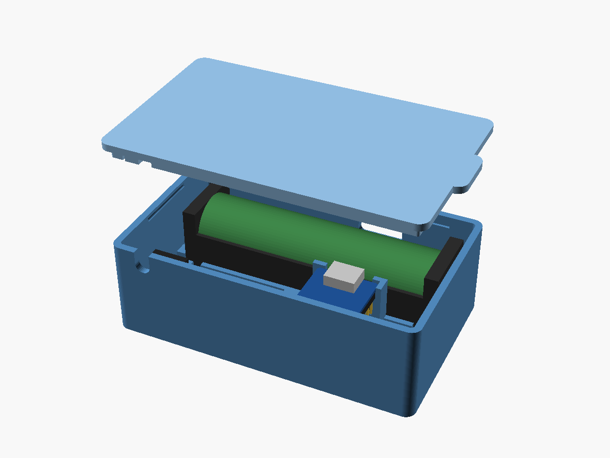
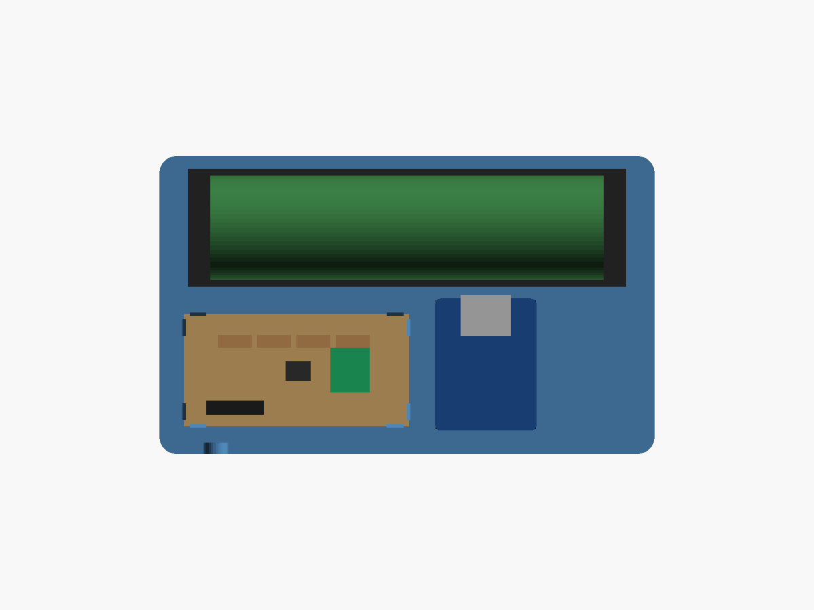
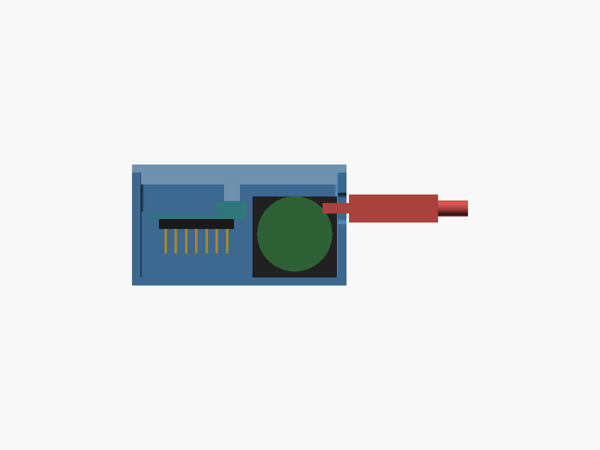
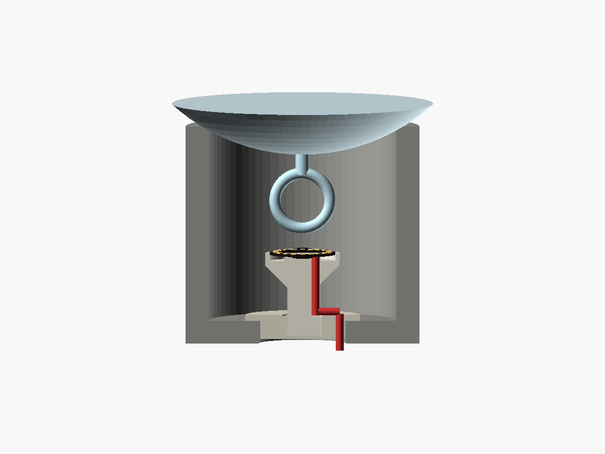

# p006 printed parts (phase 2, layout B)

Source: [p006_parts.scad](p006_parts.scad), OpenSCAD, every part in one file with its parameters at
the top (open it in OpenSCAD's Customizer, or pass `-D name=value`). `./export.sh` rewrites `stl/`
and `png/` (needs OpenSCAD 2025 or later: `brew install --cask openscad@snapshot`).
[../cad-fusion/](../cad-fusion/) holds the same parts as a Fusion script, a port kept as a template
for parts that need Fusion; this `.scad` stays the source ([why](../cad-fusion/COMPARISON.md)).

## Parts
All PLA (the 2023 PETG is probably damp and there is no dryer). Both new spools work; where it
matters, the tougher one goes where parts flex.

| Part | STL | Filament | Why that one | On the bed | ~g |
| --- | --- | --- | --- | --- | --- |
| Box, 88 × 53 × 28 mm | [p006-box.stl](stl/p006-box.stl) | eSUN PLA+ | its snap lips and the lid's detents flex at every cell swap; PLA+ bends further than plain PLA before it cracks | floor down | 32 |
| Lid, 2 mm (30 mm with the box) | [p006-lid.stl](stl/p006-lid.stl) | eSUN PLA+ | same job as the box | top face down | 13 |
| Drain-hole plug | [p006-plug_base.stl](stl/p006-plug_base.stl) | Panchroma Matte | nothing flexes; stiff and true, so the post's socket fits as drawn | flange down (upside down) | 14 |
| Ring post, ring face 30 mm up | [p006-plug_post.stl](stl/p006-plug_post.stl) | Panchroma Matte | same; a stiff seat keeps the ring level | upright, foot down | 15 |
| Ring posts for trying heights | [ring 26](stl/p006-plug_post-ring26.stl), [ring 34](stl/p006-plug_post-ring34.stl) | either | phase 1b tries heights with the orb on | upright | 15 each |
| Feet × 4, 3 mm (optional) | [p006-feet.stl](stl/p006-feet.stl) | eSUN PLA+ | tough under the concrete; felt pads do the same | flat | 3 |
| Fit test, box | [p006-fit_box.stl](stl/p006-fit_box.stl) | eSUN PLA+ | as the box | floor down | 11 |
| Fit test, plug | [p006-fit_plug.stl](stl/p006-fit_plug.stl) | Panchroma Matte | as the plug | as exported | 11 |

Grams are the solid volume at 1.24 g/cm³; the thin walls print nearly solid, so Bambu Studio's
figure will be close.

**Settings** (Bambu Studio, A1 mini, 0.4 mm nozzle, textured PEI plate): no AMS, so pick the
filament preset by hand: "eSUN PLA+" or "PolyTerra PLA" (Panchroma Matte's preset). The stock
"0.20mm Standard @BBL A1M" process, 3 walls, 15% gyroid infill, **no supports**, no brim. Every
part prints support-free the way it is exported. The plug and post in white or light grey bounce
more light up into the orb; any opaque colour keeps light off the shelf. Bag the spools with
their desiccant between prints (the garage is damp).

## 1. Fit test first
Print `fit_box` (PLA+) and `fit_plug` (Matte), ~22 g together, then check:
1. The s3mini drops into the cradle and sits flat on its two end ledges; the corner posts hold it
   without forcing; its USB-C port faces the cell's slot.
2. A USB-C cable goes in through the hole in the back wall, across the empty slot, straight into
   the port.
3. Once the holder arrives: stand it in the slot with a cell in. The plug must stop against the
   cell (that is what stops 5 V reaching the cell over USB).
4. Turn the drain-hole ring over and drop it into the pot's drain hole: it goes in with a little
   play and the flange sits flat on the floor.
5. The shaft stub slides into the socket, flat to flat, with light friction.
6. The ring drops into the seat with both outer tabs in the slots, its face just proud, level.

Tight or loose: change `clr` (0.25 now) or the one parameter at fault, run `./export.sh`, reprint.

## 2. Measure before the full print
Every one is a parameter at the top of the `.scad`; the defaults are estimates.
| What | Parameter | Default | Notes |
| --- | --- | --- | --- |
| Holder: outside length, width, height | `holder_l`, `holder_w`, `holder_h` | 78, 21, 20 | the box is sized around these |
| Holder: height of its long side walls | `holder_side_h` | 13 | the USB plug passes over them; above ~15.5 the model stops with a note: file a notch `plug_w` + 1 wide in both walls and enter its depth |
| Holder: floor under the cell | `holder_base` | 1.5 | |
| Which end of the holder is + | `plus_end` | left | the + and − marks inside the back wall follow it |
| Cell diameter | `cell_d` | 18.6 | protected cells run 18.3–18.8 |
| USB-C cable's plug body, width × height | `plug_w`, `plug_h` | 12.5 × 7 | the cable you will flash with; slim plugs fit best |
| s3mini board thickness; USB-C shell past the edge | `s3_pcb_t`, `s3_usb_over` | 1.0, 0.6 | outline and header rows are from Waveshare's drawing |
| Perfboard after cutting | `perf_l`, `perf_w` | 40 × 20 | |
| The 4-wire cable, bundled 2 × 2 | `cable_d` | 4.5 | |
| Drain hole; floor thickness at it | `drain_d`, `pot_floor` | 38.1, 10 | |
| Ring's LED face above the pot floor | `ring_z` | 30 | phase 1b with the 26/30/34 posts; the hook tip is ~38 mm up. Below ~24 the post's 45° seat no longer fits and needs supports |
| Ring: outer tab width, board thickness | `ring_tab_w`, `ring_t` | 9, 1.0 | |

## 3. Building it

- **USB only with the cell out.** The s3mini's port faces the cell across its slot, in line with
  the hole in the back wall. With the cell in, a plug pushed through the hole stops against the
  cell (section above). Cell out: the plug reaches the port.
- **s3mini:** solder the six wires (5V, GND, GPIO 1, 2, 4, 5) straight onto its header pins under
  the board; there is no room for Dupont housings there (`holder_plinth = 8` makes room: the box
  grows 8 mm taller). The 5V wire leaves on the left, the side without a corner post. The lid has
  a keeper that stops 0.3 mm over the USB-C shell, so the board cannot lift.
- **Holder:** against the back wall, between the corner stops, the leads out at its ends; two
  strips of double-sided tape or a few drops of superglue under it. A loop of ribbon under the
  cell makes it easy to lift out.
- **Perfboard:** snaps under the four corner lips. Put the 4-pin header at its front-left corner,
  under the cable notch; the housing stands upright and the cable leaves through the notch.
- **Lid:** the tab over the cable notch keys it one way round; it clicks onto both end walls; lift
  it by the pull tab on the right.
- **PIR (presence undecided):** `pir = true` cuts a 10.5 mm window in the left end wall.

- **Plug and post:** lay the cable in the groove on the plug's side, push the plug into the drain
  hole from above, bring the cable up through the flange, along the post's groove and up the
  channel under the seat; the ring goes in with its pads over the channel, tabs in the slots.
  The post's flat lines its groove up with the plug's. The plug is solid under the socket, so no
  light reaches the shelf.
- **Feet:** three under the pot (one spare), glued or taped, the cable between them.

More previews: [box](png/box-print.png), [lid](png/lid-print.png), [plug](png/plug-base.png),
[post](png/plug-post.png), [fit test, box](png/fit-box.png), [fit test, plug](png/fit-plug.png).
